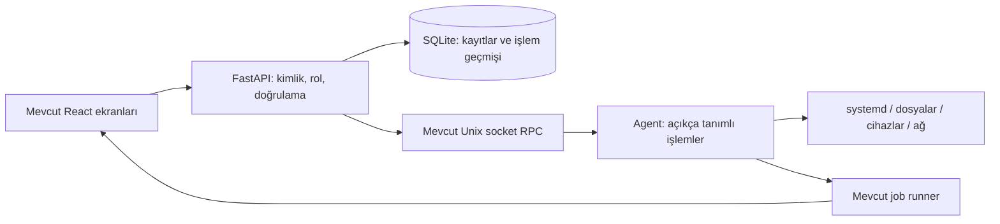

# Pi Control — Tasarım ve işlev geliştirme raporu

Tarih: 5 Kasım 2026 · İncelenen kaynak: `b763ede` · Yöntem: ECC + Ponytail.

Kapsam güncellemesi: AdGuard entegrasyonu kaldırıldı; gelecekteki NAS düzenlemesi ve üçüncü taraf app store entegrasyonu [TODO.md](../TODO.md) içinde takip ediliyor.

Bu proje Raspberry Pi'nin telemetrisini, servislerini, ağını, cihazlarını ve bakım işlemlerini web üzerinden yönetiyor. Değerlendirme tek yönetici, tek Pi ve birkaç eşzamanlı tarayıcı oturumu için yapıldı. Mevcut Pi'nin NAS olduğu varsayılmadı; NAS ilerideki bir kullanım senaryosu. Versiyon kontrolü bu raporun kapsamı dışında.

**Sonuç:** Mevcut React + FastAPI + root agent yapısı korunmalı. Öncelik yeni ekran sayısını artırmak değil, var olan ekranları günlük yönetim işlerini tamamlayacak hale getirmek. En büyük kazanım servis detayları, kullanılabilir dosya yönetimi, doğru bağlantı/işlem durumları ve tutarlı gezinmeden gelir.

Bu belge uygulama planıdır; uygulama kodu değiştirilmedi. Yeniden üretilen hatalar, test sonuçları ve operasyon riskleri [teknik denetimde](TECHNICAL_AUDIT_2026-11-05.md) ayrı verildi.

## 1. Mevcut üründe korunacaklar

- API ile ayrı agent arasındaki Unix socket sınırı; yetkili donanım işlemleri burada kalmalı.
- Telemetri geçmişi, SSE, alarm ve bildirim altyapısı.
- İş kuyruğu, işlem aşamaları ve kalıcı job kayıtları.
- USB disk keşfi, mount/unmount/eject ve tehlikeli işlemler için mevcut kimlik kontrolleri.
- Mevcut koyu/açık tema, lazy-loaded sayfalar ve test altyapısı.

Yeni frontend framework'ü, veritabanı, mikroservis veya genel plugin sistemi gerekmiyor.

## 2. Tasarım yönü

**Hedef görünüm:** Sakin, okunaklı ve bilgi yoğun bir sistem yönetim arayüzü. Sol menü, üstte sistem durumu, içerikte liste ve seçilen öğenin detay alanı. Grafikler inceleme gerektiren yerde; temel işlemler tablolar ve açık eylemlerle erişilebilir.

Kaynakta dış kabuk `--shell-*` renklerini kullanırken sayfalar mor gradient, farklı border/radius ve sayfaya özel durum renkleri kullanıyor. Bu, tek ürün yerine ayrı ekranlar hissi oluşturabilecek somut bir tutarsızlık. Yeni tema eklemek yerine mevcut renk değişkenleri sayfalara uygulanmalı.

| Alan | Mevcut durum | Önerilen değişiklik |
|---|---|---|
| Başlık | Kabuk ve sayfalar kendi başlıklarını tekrar edebiliyor | Tek sayfa başlığı, kısa açıklama, sağda ilgili ana eylem |
| Servis/dosya görünümü | Büyük kartlar çok sayıda öğeyi taramayı zorlaştırıyor | Masaüstünde sıralanabilir tablo; dar ekranda özet satır + detay |
| Detaylar | Bilgi ve eylemler listeye dağılmış | Öğeye tıklayınca detay; URL ile tekrar açılabilir |
| Durum | `Connected` sabit; eksik metrikler bazı yerlerde `0` | API, agent ve veri güncelliğini ayrı göster; ölçülemeyen değer `—` |
| İşlem sonucu | `alert`, `prompt`, `confirm` ve sayfa içi mesajlar karışık | Kısa sonuç bildirimi; hata ve işlem detayı sayfada kalıcı |
| İlerleme | Servis geçişine sabit yüzdeler atanıyor | Ölçülemeyen yüzde yerine gerçek aşama: istendi / uygulanıyor / doğrulanıyor |
| Renk | Sayfaya göre farklı başarı/hata paletleri | Başarı, uyarı, hata ve bilinmeyen için ortak semantik renkler |
| Erişilebilirlik | Dosya kartları tıklanabilir `div`; bazı ikonlar etiketsiz | Klavye ile seçim/açma, görünür focus, erişilebilir adlar |
| Mobil | Her ekran bağımsız responsive kararlar veriyor | Ortak toolbar davranışı; ana işlem görünür, ikinciller menüde |
| Hareket | Liste öğelerinde ölçek animasyonları ve `transition-all` | Durum değişimini anlatan kısa, sınırlı geçişler; reduced-motion desteği |

Bunlar kaynak ve etkileşim kodu bulgularıdır. Güncel ekranlar tarayıcıda görüntülenemediği için renk kontrastı, taşma ve piksel düzeyinde görsel uygunluk doğrulanmış sayılmıyor.

## 3. Gezinme ve ekran organizasyonu

Mevcut ekranları yeniden gruplamak yeterli; her özellik için yeni ana menü eklenmemeli.

| Grup | Ekranlar | Amaç |
|---|---|---|
| Genel bakış | Dashboard, Telemetri, Uyarılar | Ne oluyor, neye müdahale gerekiyor? |
| Yönetim | Servisler, Dosyalar, Cihazlar, Ağ | Günlük Pi yönetimi |
| Bakım | İşler, Yedekleme ve Kurtarma, Kayıtlar | Ne yapıldı, başarısızsa nasıl toparlanır? |
| Entegrasyonlar | IoT | Kurulu/etkin özellikleri yönetmek |
| Sistem | Ayarlar, Terminal | Yönetim ve ileri müdahale |

`Projects` mevcut yetenekleriyle korunabilir; versiyon kontrolü eklenmez. Dosya erişiminin proje kayıtlarına bağımlı olması kullanıcıya açıklanmalı ve bağımsız dosya kökü yönetimine dönüştürülmeli. Bu dönüşümde eski kayıtlar otomatik geniş erişim yetkisine çevrilmemeli.

**Önce düzeltilecek gezinme sorunu:** `NavigationContext` yalnız bellekte sayfa tutuyor, `App.jsx` adresi `/` yapıyor. Yenileme, geri/ileri ve doğrudan servis/dosya detayına bağlantı verme çalışır ürün davranışına dönüştürülmeli. Mevcut mimaride önce küçük bir URL/hash senkronizasyonu yeterli; yalnız bunun için router bağımlılığı eklemek gerekmiyor.

## 4. Ekran bazında işlev yükseltmeleri

### Dashboard — yalnız metrik değil, müdahale noktası

Mevcut widget düzeni korunmalı. Üste API/agent erişimi, son veri zamanı, sorunlu servisler, disk doluluk uyarıları ve devam eden işler yerleştirilmeli. Bir uyarı ilgili servis, disk veya işin detayına götürmeli.

Eksik CPU/RAM/sıcaklık verisinin `0` kabul edilmesi kaldırılmalı. Bağlantı kesilince son değer silinmez; tarih ve “güncel değil” durumu gösterilir. Ağ hızı için ilk örnek “hesaplanıyor” olmalı.

**Kabul:** Agent bağlantısı kesildiğinde ekran sağlıklı/bağlı görünmez; aynı sorun için birden fazla çelişkili durum üretilmez.

### Servisler — bir servisin sorununu bu ekranda çözebilmek

`ServicesPage.jsx` şu anda listeleme, filtreleme ve start/stop/restart etrafında kurulmuş. Liste masaüstünde ad, açıklama, durum, başlangıç ayarı, CPU/RAM ve son hata sütunlarıyla düzenlenmeli. Sistem servisleri ile kullanıcının yönettiği servisler ayrılmalı; varsayılan görünüm yüzlerce sistem satırı yerine ilgili ve sorunlu servisleri öne çıkarmalı.

Bir servis detayında:

- Durum, son geçiş, exit code, restart sayısı ve ilgili son loglar.
- Otomatik başlangıç durumu; yalnız izinli servislerde enable/disable.
- Mevcut dependencies API'sinin okunabilir bağımlılık listesi.
- Start/stop/restart için gerçek sonuç ve doğrulama; etki varsa kısa açıklama.
- Log içinde arama, zaman aralığı ve indirme. Gizli değerler ayıklanmalı.

CORE koruması korunur. SYSTEM için rol/eylem matrisi önce API ve agent'ta eşitlenir. Servis oluşturma veya unit dosyası düzenleme ilk pakete alınmaz; bunlar ayrı güvenli doğrulama gerektirir.

**Kabul:** Bir servis başarısız olduğunda listeden hatasına ve loguna ulaşılır; restart sonrası gerçek durumu görülür. İzin verilmeyen eylem UI'da gizlense bile doğrudan API çağrısında reddedilir.

### Dosyalar — mevcut en yüksek işlev açığı

Ekran `/home` ile başlıyor, Home düğmesi `/` açıyor; API ise yalnız kayıtlı proje köklerine izin veriyor. Bu başlangıç davranışı gerçek erişim modeliyle uyuşmuyor. Önce `/files/roots` kullanılarak erişilebilir kök seçilmeli; kök yoksa anlaşılır kurulum/erişim açıklaması gösterilmeli.

İlk tamamlanacak iş akışları:

1. Kök seç → klasörde gezin → geri/ileri; üst dizin düğmesi izinli kökte durur.
2. Tablo/liste, ad/tür/boyut/tarihe göre sıralama, mevcut dizinde arama, gizli dosya seçimi.
3. Çoklu seçim, kopyala/taşı için hedef seçimi, ad çakışmasında açık karar.
4. Yükleme kuyruğu: dosya bazında ilerleme, iptal, hata ve yeniden deneme.
5. Büyük dosya indirme: tarayıcı belleğine tüm dosyayı `blob` olarak almayan, mevcut auth modeline uygun akış.
6. Ad değiştirme ve klasör oluşturma için doğrulamalı form; hatalar form üzerinde kalır.
7. Silme için geri alınabilir çöp kutusu; kalıcı silme ayrı ve açık onaylı işlem.

Mevcut API'de kopyalama/taşıma var, fakat UI akışı tamamlanmamış. Önce bu yetenekler bağlanmalı. Silme, overwrite ve büyük kopyalamalar mevcut job altyapısına taşınmalı. Liste API'si sayfalama ve sınırlandırılmış iş yükü sağlamalı.

Dosya ekranındaki sudo parolasıyla “kilit açma” yalnız React state'i değiştiriyor; API'ye ek yetki kanıtı bağlamıyor. Yönetici günlük dosya işlemleri için OS parolasını tarayıcıya vermemeli. Dosya kökü izinleri sunucuda uygulanmalı; gerçekten ek doğrulama gereken işlemler mevcut break-glass yaklaşımıyla ve süreli yetkiyle korunmalı.

**Kabul:** Yetkisiz köke gezinilemez; symlink ile dışarı yazılamaz; yarıda kalan upload mevcut dosyayı bozmaz; çakışan ad sessizce üzerine yazmaz. Hedef doğrulama senaryoları küçük dosyalarla birlikte 2 GiB transfer ve 10.000 öğeli klasördür; bunlar bu denetimde performans ölçümü olarak çalıştırılmadı.

### Cihazlar ve diskler — keşfi işlemle ilişkilendirmek

USB/serial/input/GPIO keşfi korunmalı. Disk görünümü ayrı bir sekme veya filtrede kapasite, filesystem, mount noktası, read-only durumu ve ilişkilendirilmiş işleri göstermeli. “Dosyalarda aç” eylemi yalnız izinli ve mount edilmiş kök için sunulmalı.

Mount, unmount ve eject sonuçları gerçek agent gözlemiyle güncellenmeli. Busy mount için hangi sürecin/işin kullandığı açıklanmalı; otomatik force unmount yapılmamalı. Format gelişmiş/tehlikeli işlemler altında tutulmalı; rutin disk kullanımının ana eylemi olmamalı.

NAS planından bağımsız olarak sabit USB SSD/NVMe görünürlüğü ile çıkarılabilir medyada değişiklik yetkisi ayrılmalı. Mevcut `get_safe_usb_device` yalnız USB + removable aygıtları değiştiriyor; bu koruma tüm diskleri yönetebilmek adına gevşetilmemeli.

**Kabul:** Aynı disk farklı bağlantıdan geldiğinde kimlik yeniden doğrulanır; root/boot/swap diski korunur; ejection öncesi aktif işler açıkça belirtilir. Fiziksel doğrulama Pi'de yapılmalı.

### Ağ — mevcut bağlantıyı koruyarak yönetmek

Ethernet, Wi-Fi, Tailscale ve Bluetooth durumları ayrı gösterilmeli. Bağlı arayüz, IP, gateway, DNS ve internet erişimi aynı şeymiş gibi sunulmamalı.

Wi-Fi geçişi ve arayüz işlemleri mevcut checkpoint/rollback altyapısına bağlanan geri sayım ve “bağlantı doğrulandı” eylemiyle tamamlanmalı. Ağ değişikliğinden önce panelin kullandığı arayüz ve olası erişim kesintisi gösterilmeli. Kayıtlı Wi-Fi parolası geri döndürülmemeli.

**Kabul:** İletişim kaybı başarı bildirimi üretmez; yapılandırma geri döndüğünde UI yeni durumu gösterir. Canlı ağ değiştirme bu incelemede yapılmadı.

### İşler — işlemlerin ortak takip alanı

Mevcut job runner korunmalı. `pending/running/completed/failed/rolled_back/cancelled` durumlarının tamamı UI'da doğru isim ve görünümle işlenmeli; `rolled_back` şu an tanınmadığı için Pending görünümüne düşüyor.

Her uzun işlem kaynak ekranından iş detayına bağlanmalı. İş detayında aşama, başlangıç, süre, kaynak, çıktı, hata ve iptal edilebilirlik görülmeli. Handoff ile bakım sürecine devredilmek tamamlandı sayılmamalı. Yeniden deneme yalnız güvenli/idempotent işlem türlerinde sunulmalı.

### Yedekleme ve kurtarma — neyin yedeği olduğu açık olmalı

`Archive` içindeki telemetri arşivi ile sistem yedeği aynı kavram değil. Mevcut sayfa sekmelerle ayrılmalı: veri arşivi / sistem yedekleri / kurtarma.

Her yedekte kapsam, boyut, hedef, doğrulama sonucu ve gerekli anahtar durumu gösterilmeli. Yerel kayıt ile Drive'a yükleme başarısı ayrı durumlar olmalı. Mevcut sistem/DB yedeği kullanıcı dosyalarının tamamını içeriyormuş gibi sunulmamalı.

Restore önizlemesi: hangi bileşen değişecek, ne duracak, mevcut durum nasıl korunacak, başarısızlıkta ne yapılacak? Teknik denetimdeki release restore eksikleri çözülmeden UI “tam kurtarma” vaadi vermemeli.

### Telemetri, uyarılar ve kayıtlar

Telemetri sayfasındaki mevcut geçmiş/gap yaklaşımı korunmalı. Metrikten ilgili servis/diske geçiş eklenmeli. Kaynak bulunamadı ile sıfır kullanım ayrılmalı.

Uyarılar önem, kaynak ve duruma göre filtrelenmeli; acknowledge ile resolved farklı kalmalı. Topbar sayacı erişim hatasında “0 sorun” olarak yorumlanmamalı. Bildirimden kaynak detaya, oradan ilgili job/loga geçilebilmeli.

Kayıtlar yeni bir toplama altyapısı yerine mevcut logs API'leri üzerinde tarih, servis, seviye, arama ve indirme akışıyla sunulmalı. Audit kayıtları rol sınırını korumalı.

### Ayarlar, terminal ve IoT

- Ayarlar: panel hesabı, oturumlar, bildirimler ve sistem bakımı ayrı bölümler. Parola/2FA kuralları yalnız frontend'de kalmamalı.
- Terminal: ileri yönetim aracı olarak korunur; servis/dosya işlemlerindeki eksik arayüzün varsayılan çözümü olmaz. Oturum sahipliği ve süre kontrolü teknik denetimdeki bulgulara göre düzeltilmeli.
- IoT: liste → cihaz detayı → komut sonucu ilişkisi korunur; offline cihazda son veri zamanı açık olmalı. İşlemsel komut başarısı yalnız HTTP isteğinin kabulüne bağlanmamalı.

## 5. Mimari ve uygulama sırası

Şema sorumlulukları gösterir; job sonucunun UI'ya dönüşü mevcut API/SSE üzerinden olur. Dosya işlemlerinin tamamını root'a taşımak gerekmiyor. API hesabının izinli köklerde yapabildikleri aynı yetkiyle kalmalı; ayrıcalıklı işler agent'ta dar parametrelerle yürütülmeli.

| Paket | Değişiklik | Etkilenen ana dosyalar | Bitirme kanıtı |
|---|---|---|---|
| 0 — Güvenilir temel | Dosya/snapshot veri kaybı, komut sınırı, roller, kurulum/restore sorunları | `routers/files.py`, `project_service.py`, `admin_console.py`, `resources.py`, `agent/jobs/handlers.py`, kurulum scriptleri | Hataları yeniden üreten regresyon testleri + Pi'de kontrollü kabul |
| 1 — Ortak kullanım | URL gezinmesi, tek başlık, ortak tablo/durum/mesaj, veri güncelliği | `App.jsx`, `NavigationContext.jsx`, `Dashboard.jsx`, `Sidebar.jsx`, `index.css` | Yenileme/geri/ileri, klavye ve mobil kullanım |
| 2 — Günlük yönetim | Servis detayı + log; dosya kökleri ve temel dosya işlemleri | `ServicesPage.jsx`, `FilesPage.jsx`, resources/files API'leri | Servis sorunu çözme ve dosya yaşam döngüsü uçtan uca |
| 3 — Uzun işlemler | Transfer/kopya işleri, doğru job durumları, hata/iptal | `Jobs.jsx`, job runner/handler'ları, files API | Yenileme ve bağlantı kopması sırasında iş takibi |
| 4 — Operasyon | Disk/ağ ayrıntıları, yedek/restore, alarmdan kaynağa geçiş | `DevicesPage.jsx`, `NetworkPage.jsx`, `ArchivePage.jsx`, Alerts, mevcut agent servisleri | Fiziksel Pi üzerinde işlev ve kurtarma doğrulaması |

İlk somut geliştirme paketi: **servis detay paneli + dosya kökü seçimi + tutarlı işlem durumları**. Ancak dosya yazma ve restore işlevleri genişletilmeden Paket 0'daki veri güvenliği sorunları kapanmalı.

Ortak bileşen çıkarımı yalnız birden fazla sayfada gerçekten kullanılan tablo, durum ve onay akışları için yapılmalı. Bütün sayfaları baştan yazmak veya genel bileşen framework'ü kurmak kapsam dışı.

## 6. İleride sunucu/NAS kullanımına açık kalmak

Bugün Samba/NFS kurulumu, paylaşım ekranı, RAID veya disk dönüştürme yapılması önerilmiyor. Şimdiden korunacak sınırlar: disk kimliği ile mount yolu ayrı alanlar; dosya kökleri proje kavramına bağımlı değil; panel hesabı ile gelecekteki paylaşım kullanıcıları ayrı yetki alanları.

NAS gündeme geldiğinde mevcut mount, dosya, job ve audit altyapısına paylaşım yönetimi eklenebilir. Bağlı olmayan diskin mount dizinine yanlışlıkla SD karta yazma, kullanıcı/grup izinleri ve veri yedeği ayrı kabul senaryoları olur. systemd'nin mount bağımlılıkları bu aşamada değerlendirilebilir. [Resmî systemd belgesi](https://www.freedesktop.org/software/systemd/man/latest/systemd.unit)

## 7. Sınırlar ve karar noktaları

- İnceleme yerel kaynak ve testlere dayanıyor. Pi modeli, RAM, gerçek OS/Python/systemd sürümleri ve bağlı disk düzeni canlı doğrulanmadı.
- UI test/build başarısı, çalışan Pi üzerinde menülerin veya fiziksel işlemlerin kabulü değildir. Tarayıcı denemesi araç eksikliği nedeniyle sonuçlanmadı.
- İlk uygulama öncesi hedef Pi sürümleri salt okunur envanterle belirlenmeli; mevcut kurulumun üzerine geliştirme testi yapılmamalı.
- NAS ve versiyon kontrolü için uygulama, bağımlılık veya iş paketi başlatılmadı.

**Hüküm:** Önce mevcut panelin günlük yönetim işlerini güvenilir biçimde tamamlaması sağlanmalı. En yüksek değer servisler ve dosyalarda; gelecekteki sunucu özellikleri bu temel üzerine eklenmeli.
